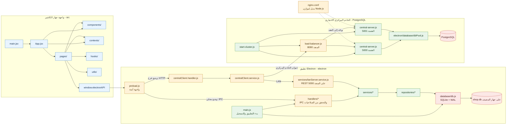

# معمارية المشروع وشجرة المجلدات

افتح الملف في VS Code ثم استخدم **Markdown: Open Preview** لعرض المخطط.

## شجرة الملفات

```text
my-electron-app/
├── src/                         واجهة React
│   ├── main.jsx                 نقطة دخول الواجهة
│   ├── App.jsx                  التنقل وتجميع الشاشات
│   ├── pages/                   صفحات النظام
│   ├── components/              مكونات الواجهة والنوافذ
│   ├── contexts/                حالة المستخدم والإعدادات
│   ├── hooks/                   منطق واجهة مشترك
│   ├── utils/                   دوال مساعدة
│   ├── styles/                  CSS
│   └── assets/                  الصور والموارد
├── electron/                    التطبيق الخلفي وعمليات Electron
│   ├── main.js                  بدء التطبيق وتسجيل المعالجات
│   ├── preload.js               جسر آمن للواجهة
│   ├── handlers/                معالجات IPC
│   ├── services/                منطق الأعمال والعملاء والخوادم
│   ├── repositories/             استعلامات وتخزين البيانات
│   ├── database/                SQLite وPostgreSQL والمخططات
│   ├── security/                الصلاحيات والبروتوكولات الآمنة
│   └── validators/              التحقق من مدخلات الطلبات
├── shared/                      ملفات مشتركة، مثل permissions.json
├── tests/                       اختبارات الوحدات والتكامل والأمان
│   ├── frontend/ handlers/ services/ validators/
│   ├── integration/ security/ recovery/ performance/
│   ├── smoke/ snapshots/
├── e2e/                         اختبارات Electron من البداية للنهاية
├── scripts/                     سكربتات مساعدة
├── rules/                       قواعد وإعدادات للمشروع
├── public/                      موارد الواجهة العامة
├── build/                       أيقونات وموارد تغليف Electron
├── api-server.js                API محلي لاختبارات Postman
├── central-server.js            خادم مركزي يعتمد PostgreSQL
├── start-cluster.js             تشغيل عقدتي API وموازن الأحمال
├── load-balancer.js             موازن أحمال Node.js
├── nginx.conf                   إعداد بديل لموازن Nginx
├── scripts/test-db.js           فحص قاعدة البيانات
├── scripts/verify-connection.js فحص اتصال قاعدة البيانات
├── vite.config.js               إعداد بناء React
├── package.json                 الأوامر والاعتماديات
└── README.md                    تعليمات التشغيل والتوثيق
```

`dist/` و`coverage/` و`release/` و`node_modules/` مخرجات أو اعتماديات مولدة، وليست مصدرًا أساسيًا. ملف `.env` للإعدادات السرية؛ لا تضع محتواه في المخططات أو المستندات.

## مسارات التشغيل



## وظيفة كل جزء

- **`src/`**: يعرض الشاشات ويتعامل مع واجهة `window.electronAPI` فقط؛ لا يتصل بقاعدة البيانات.
- **`electron/preload.js`**: يعرّف API محدودًا وآمنًا بين React وعملية Electron. يختار بعض الطلبات محليًا عبر IPC أو يوجهها إلى خادم الفرع.
- **`electron/handlers/`**: يستقبل IPC، يطبق فحوص الصلاحيات عبر `safeHandle.js`، ثم يستدعي خدمات الخلفية.
- **`electron/services/`**: منطق الأعمال، خادم LAN، عميل الخادم المركزي، النسخ الاحتياطي، الطباعة والتحديثات.
- **`electron/repositories/`**: الوصول إلى البيانات. خدمات SQLite تستخدم `electron/database/db.js`؛ الخادم المركزي يستخدم `dbPool.js` مع PostgreSQL.
- **LAN بفروع SQLite**: أجهزة الكاشير تتصل بواجهة المضيف عبر HTTP؛ ملف SQLite يظل محليًا على المضيف ولا يوضع في مجلد مشترك.
- **PostgreSQL المركزي**: `start-cluster.js` يشغل عقدتين من `central-server.js` وموازن `load-balancer.js`. يمكن استخدام `nginx.conf` كإعداد بديل للموازنة.
- **`api-server.js`**: خادم REST مساعد لاختبارات Postman، وليس هو خادم LAN الخاص بتطبيق Electron.
- **الاختبارات**: `tests/` يغطي الوحدات والتكامل والأمان والاستعادة والأداء؛ `e2e/` يختبر التطبيق كاملًا.
- **البناء**: `vite` يبني الواجهة إلى `dist/`، ثم Electron Builder يغلّف التطبيق في `release/`.

## التحقق الفعلي الحالي

### 1) ما تم تأكيده في الكود
- كل فرع/آلة يملك قاعدة بيانات SQLite محلية، ويتم تهيئتها في `electron/database/db.js`.
- وضع WAL مفعّل عبر `db.pragma('journal_mode = WAL')`.
- `db.backup()` هو واجهة النسخ الاحتياطي الصحيحة.
- الاستعادة تستدعي `closeDatabase()` ثم تستبدل الملف من نسخة احتياطية، مع تنظيف ملفات `-wal` و`-shm` بعد الاستعادة.
- خادم LAN في `electron/services/lanServer.service.js` يعمل كنقطة HTTP للطلبات، وليس كقاعدة بيانات مشتركة.
- `api-server.js` يربط على `127.0.0.1` فقط، لذا لا يفتح لواجهة LAN بشكل مباشر.
- `requirePermission()` لا يتجاوز التحقق، بل يستدعي `requireAuth()` أولًا قبل فحص الصلاحيات.

### 2) ما تم إبطاله بعد التحقق
- ليس هناك دليل فعلي على أن WAL لا يدخل في النسخة الاحتياطية.
- ليس هناك دليل فعلي على أن LAN يخترق SQLite محليًا كقاعدة واحدة مشتركة.
- ليس هناك دليل فعلي على وجود bypass في auth داخل الكود الحالي.

### 3) ما تم تقويته فعليًا
- تم تحسين استعادة النسخة الاحتياطية إلى كتابة ملف مؤقت ثم استبدال الملف بشكل ذري، لتجنب الكتابة المباشرة الجزئية إلى قاعدة البيانات الحالية.
- تم إضافة اختبارات صارمة للتحقق من احتواء النسخ الاحتياطي للبيانات الموجودة في WAL.
- تم إضافة اختبارات للتحقق من تنظيف ملفات WAL و SHM أثناء الاستعادة.

### 4) ما الذي سيُدار لاحقًا إن أردنا تعزيز الأمان
- التحقق من سلامة ملف النسخة الاحتياطية قبل الاستعادة
- الاحتفاظ بعدد محدود من النسخ الاحتياطية اليومية والشutdown
- كتابة سجل Restore Audit
- استخدام backup على ملف مؤقت ثم rename بأمان في نفس المجلد
- مراجعة صلاحيات الوصول عبر LAN فقط للفرع/الآلة المسماة

## حدود المخطط

العلاقات داخل `src/` تعتمد على `import`. الأسهم بين preload وIPC وHTTP وقواعد البيانات تشرح تدفق التشغيل؛ هذه العلاقات لا تظهر كلها في أدوات تحليل الاستيراد مثل Madge.